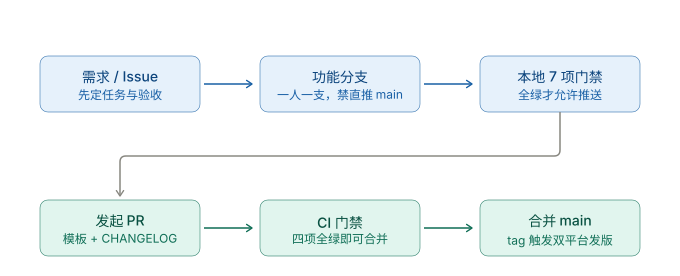

# DeskPanda 协作开发规范

> 生效日期：2026-11-20。适用对象：仓库 owner 与全部协作者（含 AI 协作会话）。
> 本文件定义**人与人协作**的规矩；代码本身的技术纪律见根目录 `CLAUDE.md`，
> 两者冲突时以 `CLAUDE.md` 的技术条款为准。

## 协作流程概览



## 1. 角色与权限

| 角色 | GitHub 权限 | 能做什么 | 不能做什么 |
|------|------------|---------|-----------|
| Owner（lzlkyb） | Admin | 一切，含发版、改 secrets、改分支保护 | — |
| 协作者（kynnzhou 及后续加入者） | Write | 建分支、push 分支、提 PR、审 PR、合 PR | 直推/强推 `main`、改仓库设置、读取 secrets |

**安全红线**：签名私钥 `TAURI_SIGNING_PRIVATE_KEY`、`GITEE_TOKEN` 等 secrets 仅 owner 可见。
协作者永不获得 Admin——拿着签名私钥就能发假更新包，这是供应链级风险。

## 2. 分支模型

- `main` 是唯一集成分支，**受保护**，常态保持可发版状态。
- 功能开发一律开分支，命名前缀即类型：

  | 前缀 | 用途 | 示例 |
  |------|------|------|
  | `feat/` | 新功能 | `feat/file-transfer` |
  | `fix/` | 修复 | `fix/tray-refresh` |
  | `refactor/` | 重构 | `refactor/split-connect-tab` |
  | `docs/` | 文档 | `docs/collab-guide` |

- 分支生命周期尽量短（一到数天），合完即删，避免长期分叉。
- 🔴 **禁止直推 `main`**。owner 直推仅允许一种场景：发版脚本 `npm run release`
  的自动 push（见 §6）。

## 3. 标准工作流

```
1. 领任务      → Issue 里认领或新建，写清验收标准（复杂任务先出方案，见 CLAUDE.md §1）
2. 建分支      → git switch -c feat/xxx
3. 本地开发    → 遵守 CLAUDE.md 全部技术规则；UI 改动先出 HTML 设计稿
4. 起 dev 自测  → 前端 HMR 热更；改 Rust 要重启
5. 提交        → 按 §4 的 commit 前缀；提交前逐文件审 diff（CLAUDE.md §14）
6. push 分支   → git push -u origin feat/xxx（pre-push 钩子跑 9 项门禁）
7. 提 PR       → 用 .github/PULL_REQUEST_TEMPLATE.md 模板，勾选自检项
8. 等 CI → 4 项 required checks 全绿即可合并；Review 仍鼓励，但不作为强制门槛
9. 合并        → Squash merge 进 main；源分支由仓库设置「合并后自动删除」接管，无需手动删
```

## 4. Commit 与 CHANGELOG

- 前缀沿用 `CLAUDE.md`：`feat:` / `chg:` / `fix:` / `refactor:` / `docs:`。
- 一次 commit 一件事，message 说清「为什么」而不只是「改了什么」。
- 🔴 **版本号只有一个真源**（`desktop/src-tauri/Cargo.toml`）。日常改动**不动版本号**，
  只在 `CHANGELOG.md` 的 `## [Unreleased]` 按 新增/变更/修复 追加条目。
- 只有 owner 说「打 tag」才走发版流程 bump 版本。

## 5. PR 与 Review 规则

- **合并门槛**（已配置到分支保护）：
  - 必须通过 PR，禁止直推；
  - 4 项 CI 检查全绿：`Frontend (tsc + vitest + build)`、`工具链口径一致`、
    `Rust test suite (Windows)`、`Rust check + test (macOS)`；
  - 分支与 `main` 保持同步（strict）；
  - 禁止强推、禁止删除 `main`；要求线性历史。
- **不要求人工审批**（2026-11-20 起）：`required_approving_review_count = 0`。
  协作者的 PR 只要 4 项 CI 全绿即可自行合并，无需 owner 点头。
  原因是 GitHub 分支保护无法按用户豁免审批，而当前仅有一名协作者；
  取消审批对 owner 无影响（owner 本就因 `enforce_admins=false` 可直推）。
- **Review 看什么**（仍鼓励，但不阻塞合并）：逻辑正确性与边界、是否违反 `CLAUDE.md`、
  体积/性能影响、安全（路径白名单、凭据泄漏）、测试覆盖、CHANGELOG 是否更新。
- CODEOWNERS 会自动把 owner 加为架构类文件的 reviewer（见 `.github/CODEOWNERS`），
  仅作提醒，不构成审批门槛。
- 🔴 **架构性改动仍需先出方案**：涉及 §7 列出的分层、依赖、发版链、安全模块时，
  即使 CI 放行也要先在 Issue/PR 里讨论确认——这条靠人自觉，不靠 GitHub 拦截。

## 6. 发版（仅 owner）

- owner 一旦说「打 tag」，由 owner 执行 `npm run release`，脚本自动 bump → 同步版本 →
  写 CHANGELOG → commit → push main → tag → push tag → CI 双平台构建发版。
- 🔴 **发版前必须停 dev**（钩子与发版都要跑 cargo，争抢 `target/` 锁会失败）。
- 发版直推 `main` 是分支保护的**唯一豁免**：保护对协作者严格执行（enforce_admins=false
  让 owner 保留发版所需的直推能力）。这是刻意设计——不这样做，`release.mjs` 会当场失效。
- 完整步骤与四个「脚本替你做不了」的坑见 `CLAUDE.md`「发版流程」。

## 7. 冲突与决策

- 架构性取舍（改分层、引依赖、动发版链/安全模块）：**先出方案，2-3 个选项对比**，
  在 Issue/PR 里讨论确认再动手（CLAUDE.md §1、§7）。
- 两边改同一文件冲突：谁的功能谁解决；跨模块冲突拉对方一起看。
- CI 红灯不得强行合并；本地与 CI 工具链口径必须一致（由 `工具链口径一致` job 把关）。

## 8. 新协作者上手清单

1. 接受 GitHub 仓库邀请（Write 权限）。
2. 按 `README.md`「快速开始」配环境：Node 22+、Rust 1.96.0（见 `rust-toolchain.toml`）、
   Tauri 2 系统依赖。
3. 启用 pre-push 钩子：`git config core.hooksPath .githooks`（本仓入库带可执行位）。
4. 通读 `CLAUDE.md`（工程纪律）与本文件（协作规矩），重点看 §2 版本号、§4 体量门禁、
   §8.1 后台循环六问、发版流程。
5. 读 `docs/代码整洁与防死代码规范-2026-11-21.md`：死代码不是品味问题是门禁问题
   （knip / cargo machete 已进 pre-push 9 项门禁），动手删代码前先看其中的「删除四查」。
6. 先认领一个小任务，走完一遍 §3 全流程再接大活。
